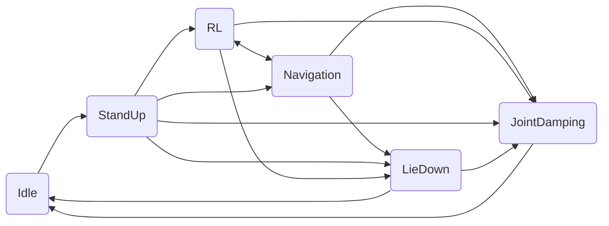
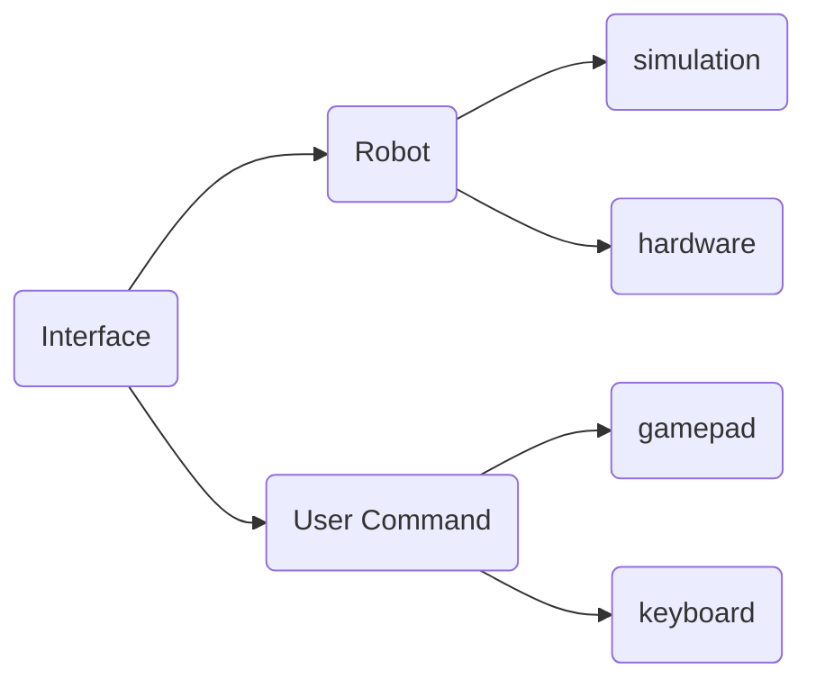

[English](./README_EN.md)

[](https://discord.gg/gdM9mQutC8)
请全程在Ubuntu系统上进行
## Tutorial Video
欢迎在[Bilibili](https://b23.tv/UoIqsFn)或者[YouTube](https://youtube.com/playlist?list=PLy9YHJvMnjO0X4tx_NTWugTUMJXUrOgFH&si=pjUGF5PbFf3tGLFz)观看教程视频，学习如何训练和部署强化学习策略。

# 仿真-仿真
```bash
# segmentation debug 工具安装
sudo apt-get install libdw-dev
wget https://raw.githubusercontent.com/bombela/backward-cpp/master/backward.hpp
sudo mv backward.hpp /usr/include

# 依赖安装 (python3.10)
pip install pybullet "numpy < 2.0" mujoco
git clone --recurse-submodule https://github.com/DeepRoboticsLab/Lite3_rl_deploy.git

# 编译
mkdir build && cd build
cmake .. -DBUILD_PLATFORM=x86 -DBUILD_SIM=ON -DSEND_REMOTE=OFF
# 指令解释
# -DBUILD_PLATFORM：电脑平台，Ubuntu为x86，机器狗运动主机为arm
# -DBUILD_SIM：是否使用仿真器，如果在实机上部署设为OFF 
make -j
```

```bash
# 运行 (打开两个终端)
# 终端1 (pybullet)
cd interface/robot/simulation
python3 pybullet_simulation.py

# 终端1 (mujoco)
cd interface/robot/simulation
python3 mujoco_simulation.py

# 终端2 
cd build
./rl_deploy
```

### 操控(终端2)

tips：可以将仿真器窗口设为始终位于最上层，方便可视化

**键盘控制：**
- z： 机器狗站立进入默认状态
- c： 机器狗站立进入rl控制状态
- x： 机器狗趴下
- r： 关节阻尼模式
- wasd：前后左右
- qe：顺逆时针旋转

**Xbox手柄控制：**

仿真模式下会自动检测Xbox手柄，如果检测到手柄则使用手柄控制，否则使用键盘控制。

- 左肩键 LB：机器狗站立（对应键盘z）
- 右肩键 RB：进入RL控制状态（对应键盘c）
- X：机器狗趴下（对应键盘x）
- 左扳机 LT：关节阻尼模式（对应键盘r）
- 左摇杆 上下：前后移动（对应键盘ws）
- 左摇杆 左右：左右平移（对应键盘ad）
- 右摇杆 左右：转向（对应键盘qe）


# 仿真-实际
此过程和仿真-仿真几乎一模一样，只需要添加连wifi传输数据步骤，然后修改编译指令即可。目前默认实机操控为retroid手柄模式，如需使用键盘模式，可在state_machine/state_machine.hpp中第121行更改为
```bash
uc_ptr_ = std::make_shared<KeyboardInterface>();
```
修改ip：进入jy_exe/conf/network.toml，修改ip为以下内容
ip 192.168.1.120 是运控在机器人运动主机上运行
ip 192.168.1.102 是遥控器连接的wifi地址
```bash
ip = '192.168.1.120'
target_port = 43897
local_port = 43893

ips = ['192.168.1.102']
ports = [43897]
```
```bash
# 电脑和手柄均连接机器狗WiFi
# WiFi名称为 YSC-JYML-xxxxxx
# WiFi密码为 12345678 (一般为这个，如有问题联系技术支持)

# scp传输文件 (打开本地电脑终端)
scp -r ~/Lite3_deploy firefly@192.168.1.120:~/
# ssh连接机器狗运动主机以远程开发
#Username	Password
#ysc		' (a single quote)
ssh firefly@192.168.1.120
# 输入密码后会进入远程开发模式

# 编译
cd Lite3_deploy/
rm -rf build/
mkdir build && cd build
cmake .. -DBUILD_PLATFORM=arm -DBUILD_SIM=OFF -DSEND_REMOTE=OFF
# 指令解释
# -DBUILD_PLATFORM：电脑平台，Ubuntu为x86，机器狗运动主机为arm
# -DBUILD_SIM：是否使用仿真器，如果在实机上部署设为OFF 
make -j 
./rl_deploy
```

## 操控(手柄)

参考https://github.com/DeepRoboticsLab/gamepad

- Y：机器狗站立
- A：进入RL控制状态
- X：机器狗趴下
- 同时按下左右摇杆：关节阻尼模式
- 左摇杆：前后左右移动
- 右摇杆：顺逆时针旋转

## 模型转换

运行RL训练出的策略文件需要链接onnxruntime库，而onnxruntime支持的模型为.onnx格式，需要手动转换.pt模型为.onnx格式。

可以通过运行policy文件夹中的pt2onnx.py文件将.pt模型转化为.onnx模型。注意观察程序输出对两个模型一致性的比较。

首先配置和验证程序运行环境

```bash
pip install torch numpy onnx onnxruntime

python3 -c 'import torch, numpy, onnx, onnxruntime; print(" All modules OK")'
```

然后运行程序

```bash
cd your/path/to/LITE3_RL_DEPOLY/policy/

python pt2onnx.py
```
就可以在当前文件夹看到对应的.onnx模型文件了


## 各模块介绍

### SEA-Nav 感知主机 TCP 接口

`rl_deploy` 内置一个纯 TCP server，用于连接运行 ROS1/A-LOAM 的感知主机，默认监听
`0.0.0.0:29001`。协议是 UTF-8、换行分隔的 JSON，不依赖 ROS。

感知主机发送导航命令（单位为 m/s、m/s、rad/s）：

```json
{"version":1,"type":"nav_command","stamp":1710000000.14,
 "vx":0.4,"vy":0.0,"vyaw":0.1,"enable":true,"emergency_stop":false}
```

运动主机周期回传策略观测需要的状态：

```json
{"version":1,"type":"motion_state","stamp":1710000000.12,
 "projected_gravity":[0.0,0.0,-1.0],
 "last_nav_command":[0.2,0.0,0.0],"enabled":true,"standing":true}
```

Lite3 侧会把命令限幅到 `vx[-0.5,0.5]`、`vy[-0.5,0.5]`、
`vyaw[-0.8,0.8]`，再以 `alpha=0.5` 滤波。控制来源由机器人本地模式决定：

| 模式 | 速度来源 | 摇杆方向 | TCP 状态 |
| --- | --- | --- | --- |
| RLControl（6） | 遥控器 | 有效 | 忽略 TCP 速度和远端急停请求 |
| Navigation（7） | SEA-Nav TCP | 禁用 | 无有效命令、超时或 `enable=false` 时目标速度为零，经滤波减速 |

导航模式的 `emergency_stop=true` 会切换到关节阻尼。进入导航时清除先前 TCP
命令，等待新命令；退出导航后恢复遥控。两种模式共用同一份底层 ONNX 运控模型。
本地阻尼、趴下按键和姿态保护始终有效。

Retroid 按键（按下触发）：

| 按键 | 功能 |
| --- | --- |
| Y | 从等待状态站起 |
| A | 站起后进入 RL 遥控；从导航返回 RL 遥控 |
| B | 站起后或 RL 模式下进入导航 |
| X | 站起后、RL 或导航模式下趴下 |
| 双摇杆按下 | 进入关节阻尼 |

仿真键盘：`z` 站起、`c` 遥控 RL、`n` 导航、`x` 趴下、`r` 阻尼。
Xbox：LB 站起，站起后再次按 LB 进入导航；RB 进入/返回遥控 RL；X 趴下；LT 阻尼。
真机默认使用 Retroid；Skydroid 接口未配置导航按键。

回传 `enabled=true` 仅表示导航模式，`standing=true` 表示 RL 或导航模式。
RL 模式回传 `enabled=false, standing=true`，感知主机据此暂停有效导航命令。
`last_nav_command` 始终是当前实际应用的滤波速度，包括遥控模式速度。

感知主机应能访问运动主机的 `29001/tcp` 端口。运动主机上的防火墙、网卡地址
或端口变化时，修改 `state_machine/state_machine.hpp` 中的 bridge 构造参数后重新编译。

### state_machine




state_machine模块是Lite3在不同的状态之间来回切换，不同的状态代表的功能如下：

1.Idle 空闲状态，表示机器狗处于关节不发力的情况

2.StandUp 站起状态，表示机器狗从趴下到站起的动作

3.RL 遥控状态，摇杆速度输入底层运控策略

4.JointDamping 关节阻尼状态，表示机器狗的关节处于阻尼控制状态

5.LieDown 趴下状态，表示机器狗从站立状态切换到趴下状态，动作完成后回到Idle

6.Navigation 导航状态，SEA-Nav TCP 速度输入底层运控策略，忽略摇杆方向

### interface



interface模块表示机器狗的数据接受和下发接口和手柄控制的输入。其中机器狗平台的输入分为仿真和实物，手柄的输入分为键盘和手柄控制。

### run_policy


这部分用于执行RL策略的输出，新的策略可以通过继承policy_runner_base实现。
